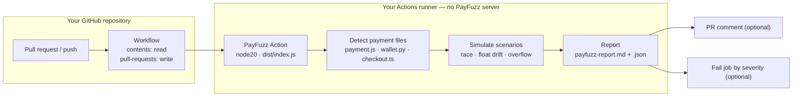

<div align="center">


# PayFuzz

**Break your payment logic before an attacker does.**
_Before the attacker, break your own payment logic._

[](https://github.com/jalaljavadi166-netizen/payfuzz/actions/workflows/ci.yml)
[](LICENSE)
[](https://www.npmjs.com/package/payfuzz)
[](package.json)

</div>

A payment-logic fuzzer and attack simulator that runs in your CI — never touches real money, real keys, or your wallet.

> **Status:** Phase 4 of the MVP — payment-file detection, all three scenarios (float drift, race condition, negative/overflow amount), `.payfuzz.yml` and the local CLI work. Tests, the bundled `dist/` and the Action wiring land in the next phases.

---

## 1. What PayFuzz will NEVER do

This section is the product. It is not a policy we may relax later; it is the architecture.

| | Guarantee |
| --- | --- |
| 🔑 | **Never touches a live key.** No `sk_live_`, no private key, no seed phrase, no wallet. PayFuzz only understands test keys (`sk_test_…`) and sandbox addresses. |
| 👛 | **Never connects to a wallet.** It never signs, never broadcasts, never holds funds. It reads your code and simulates logic in memory. |
| 🖥️ | **Never uploads your code.** It runs on *your* GitHub Actions runner. There is no PayFuzz server in the loop and no telemetry. |
| ✍️ | **Never writes to your repository.** The only permissions it requests are `contents: read` and `pull-requests: write`, and the only artifact it produces is a Markdown/JSON report. |

## 2. How it works



PayFuzz never receives a request from your CI, and your CI never sends one out.

## 3. Install and quick start

Added with the working CLI and action in later phases. The intended shape:

```yaml
- uses: jalaljavadi166-netizen/payfuzz@v0
  with:
    fail-on: high
```

## 4. Example report

Generated by the real detector on a small checkout file. Trimmed here to two findings; the full report lists all of them plus every scanned file.

````markdown
<!-- payfuzz-report -->

# PayFuzz report

> Simulated in memory on your CI runner. PayFuzz parsed your source — it did not execute it, did not read a key, and did not move money.

**3 high · 2 medium · 0 low** — 5 findings in 2 files.

## Summary

| # | Severity | Scenario | Location | Finding |
| --- | --- | --- | --- | --- |
| 1 | 🔴 high | `float_drift` | `src/payments/checkout.ts:15:11` | Decimal literal arithmetic on money |
| 2 | 🟠 medium | `float_drift` | `src/api/orders.ts:4:10` | Exact equality comparison on a money amount |

## Findings

### 1. 🔴 high — Decimal literal arithmetic on money

**Scenario:** `float_drift` · **Rule:** `PF-FLOAT-001` · **Location:** `src/payments/checkout.ts:15:11`

```ts
total + 0.1
```

**Simulated:** `0.1 + 0.2` evaluates to `0.30000000000000004`

**Financial risk:** Binary floating point cannot represent most decimal amounts exactly, so a total
that drifts stops reconciling with the payment provider. The app can under-charge a customer,
over-refund one, or leave a balance that never reaches zero.

**Suggested fix:** Keep money in integer minor units (cents, paise, satoshi) and do the arithmetic
on integers. Format only at the edge: `(amountCents / 100).toFixed(2)`.
````

## 5. Supported scenarios

| Scenario | What it catches | Rules |
| --- | --- | --- |
| Floating point drift | `0.1 + 0.2` style arithmetic on money, and `===` on amounts | `PF-FLOAT-001` decimal literal arithmetic · `PF-FLOAT-002` money arithmetic · `PF-FLOAT-003` exact equality |
| Race condition | Two concurrent transactions on one balance: read-modify-write (directly or through a local variable written back by a function call), check-then-act, and a balance read before an `await` and written back after it | `PF-RACE-001` · `PF-RACE-002` · `PF-RACE-003` |
| Negative / overflow amount | Unvalidated amounts reaching money code, and literals that already lost precision | `PF-OVERFLOW-001` unguarded amount · `PF-OVERFLOW-002` unsafe literal · `PF-OVERFLOW-003` unvalidated parse |

Python support (tree-sitter) is a post-MVP phase; the MVP parses TypeScript/JavaScript with `ts-morph`.

## 6. Configuration (`.payfuzz.yml`)

Every key is optional. Without a file PayFuzz auto-detects payment files and enables all three scenarios at `medium` sensitivity.

```yaml
payment_paths: # scan only these paths instead of auto-detecting
  - src/payments
  - src/wallet/checkout.ts
scenarios: # turn a scenario off without touching your code
  race_condition: true
  float_drift: true
  overflow_amount: false
sensitivity: medium # low | medium | high
```

| Key | Default | What it does |
| --- | --- | --- |
| `payment_paths` | `[]` (auto-detect) | Files and directories to scan, relative to the repository root. A listed directory is treated as payment code in full; `src/payments/**` is accepted as shorthand for `src/payments`. Paths that are absolute or leave the repository are rejected. |
| `scenarios` | all `true` | `race_condition`, `float_drift`, `overflow_amount`. Unknown ids are ignored with a warning; a non-boolean value is an error. |
| `sensitivity` | `medium` | Shifts every rule one level: `low` relaxes, `high` raises. Clamped to `low…high`, so a rule never disappears. |

Invalid YAML, an unknown key, a bad sensitivity or a path outside the repository fails the run with a message that points at [SECURITY.md](SECURITY.md).

## 7. Local run

```bash
# scan the current repository with ./.payfuzz.yml (if present)
npx payfuzz

# scan a subdirectory with an explicit config and report path
npx payfuzz ./services/checkout -c .payfuzz.yml -o payfuzz-report.md

# machine-readable output and a CI gate
npx payfuzz --json --fail-on high
```

| Flag | Default | What it does |
| --- | --- | --- |
| `[path]` | `.` | Repository root (or subdirectory) to scan. |
| `-c, --config <path>` | `.payfuzz.yml` | Config file, relative to `[path]`. A missing default file just means defaults; a missing file you named is an error. |
| `-o, --output <path>` | `payfuzz-report.md` | Where the Markdown report is written. `--json` writes the same data next to it as `.json`. |
| `--fail-on <severity>` | `high` | Exit code `1` when a finding reaches this severity (`low`, `medium`, `high` or `never`). |
| `--sensitivity <level>` | from config | Override `sensitivity` for this run. |

Exit code is `0` for a clean run or findings below `--fail-on`, and `1` for a gate failure or any error. Reports are the only files PayFuzz writes.

## 8. Security FAQ

See [SECURITY.md](SECURITY.md) for the threat model. Short answers:

- **Does it need my Stripe key?** No. It never makes network calls.
- **Does it store my code anywhere?** No. There is no backend.
- **Can it leak secrets into the PR comment?** No. Reports contain file paths, line numbers and code snippets from the flagged lines only — never environment values.

## 9. Contributing & Sponsorship

See [CONTRIBUTING.md](CONTRIBUTING.md) (added with the test suite) for the workflow, and [docs/security-model.md](docs/security-model.md) for the rules a contribution must not break.

| Tier | Price | What you get |
| --- | --- | --- |
| **Core** | Free, MIT | Every security scenario, forever. No security capability is ever paywalled. |
| **Sponsor** | $5+/month | Early access to new scenarios. |
| **Team** | $49/month | Team reports, custom scenarios, support. |
| **Enterprise** | Contact | Self-hosted deployment, SLA, audited reports. |

## 10. License

[MIT](LICENSE).
